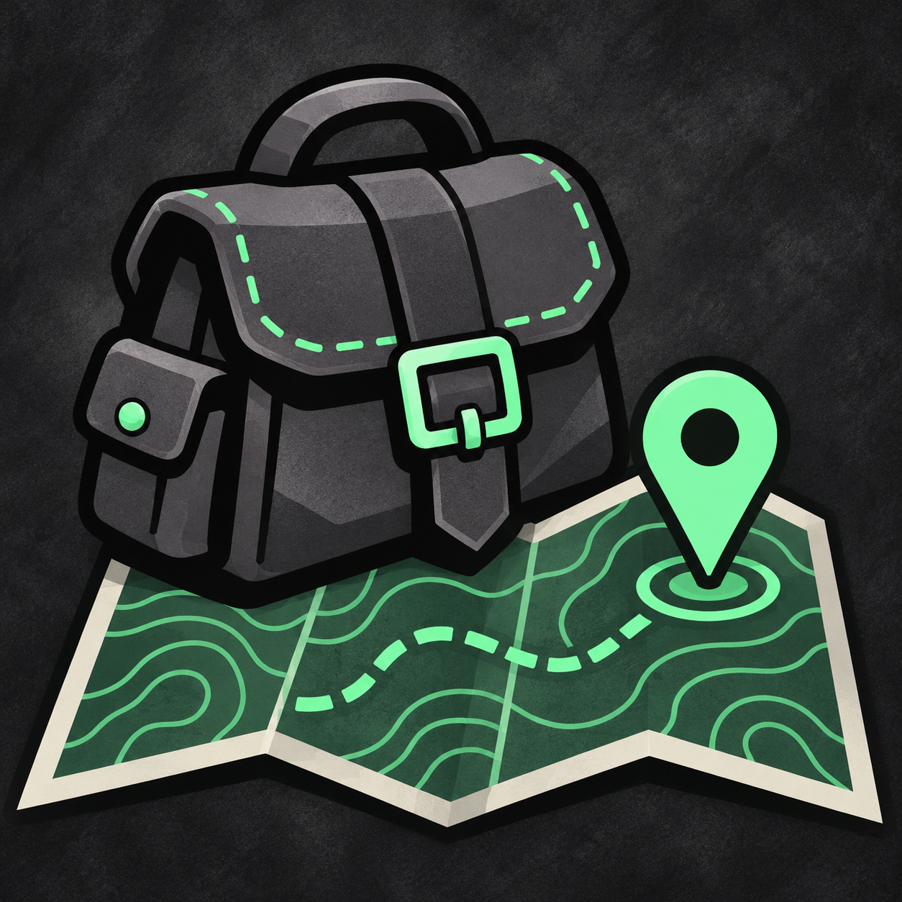

# Questfund

Find quest items in your bags and bank, see what repeatable turn-ins still need, and track the right NPC on the map.

Questfund targets **World of Warcraft: Forever 1.60.1**. The in-game interface is in German. [Download the release ZIP](https://github.com/zonfacter/questfund/releases/latest) and extract the `Questfund` folder into `Interface/AddOns`.

1. Open `/questfund` or use the optional Titan Panel launcher.
2. Open your personal bank once to record its contents. The window shows the time of the last scan while the bank is closed.
3. Choose **Wiederholbar** to see turn-in requirements. Click the coordinates for the world map or **Verfolgen** to start tracking directly on the minimap. Click the marker or tracker for a small zone map.

The turn-in list checks the quest and the destination's faction restrictions. Counts are shown per turn-in, with separate bag and bank totals, how many items to pick up from the bank, and how many are still missing. The navigation distance is a straight-line estimate to the recorded spawn. Quest prerequisites and reputation can still affect availability.

## Development

Run the simulated client tests with `python tests/test_questfund.py` after installing `lupa`. [Data sources and rebuild instructions](Questfund/DATA-SOURCES.md) explain how the committed indexes were generated.

Questfund's original code is licensed under [GPL-3.0-only](LICENSE). [Data sources and upstream notices](Questfund/DATA-SOURCES.md) cover the bundled reference data.
